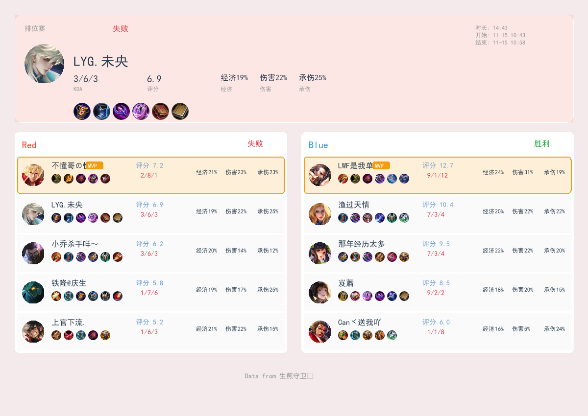
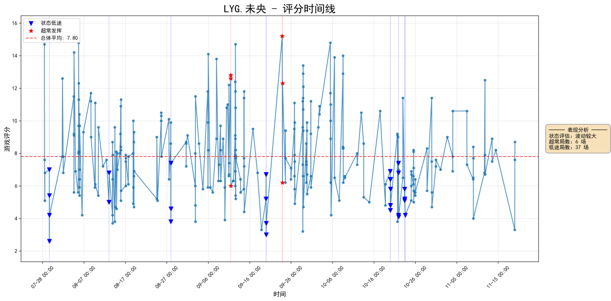
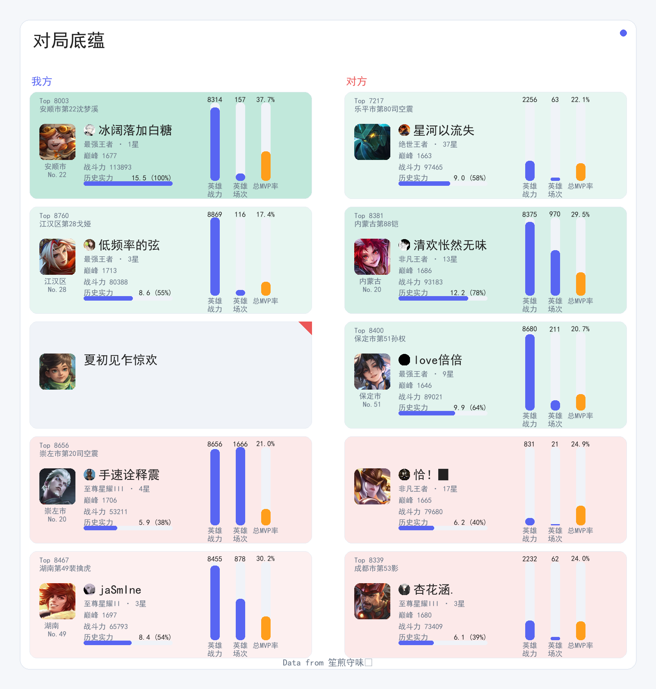
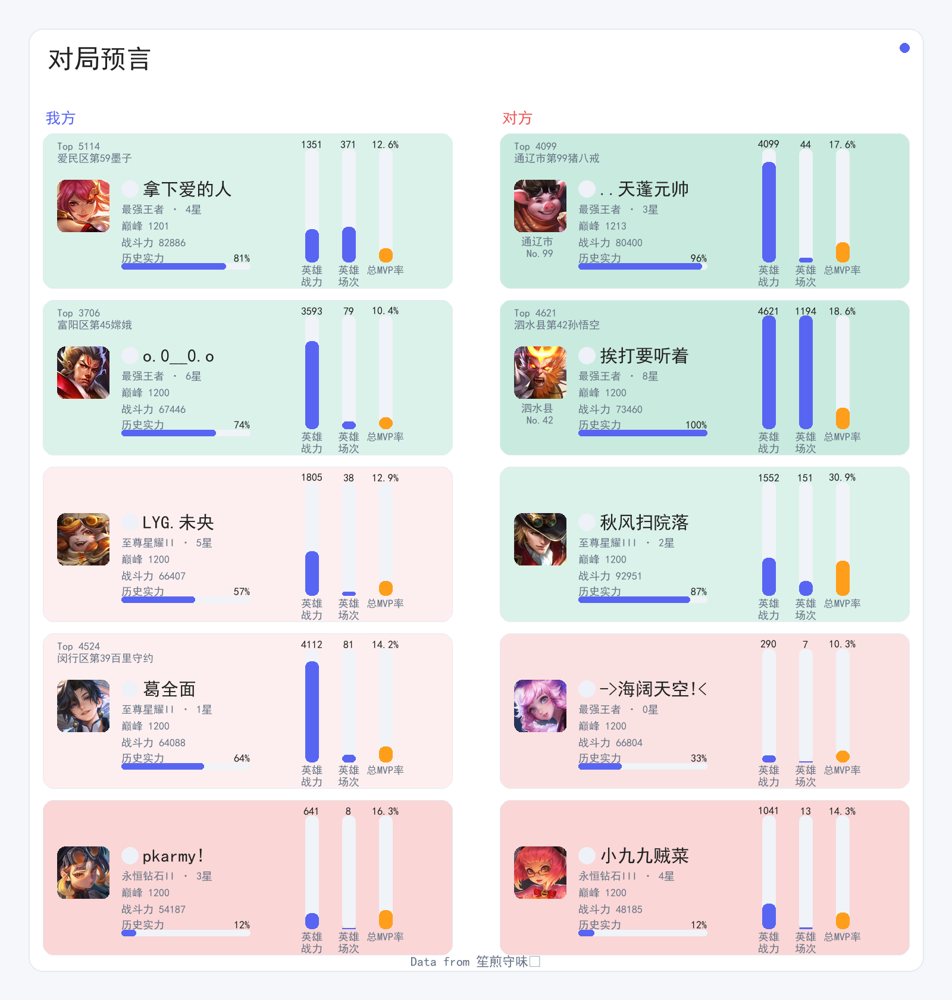
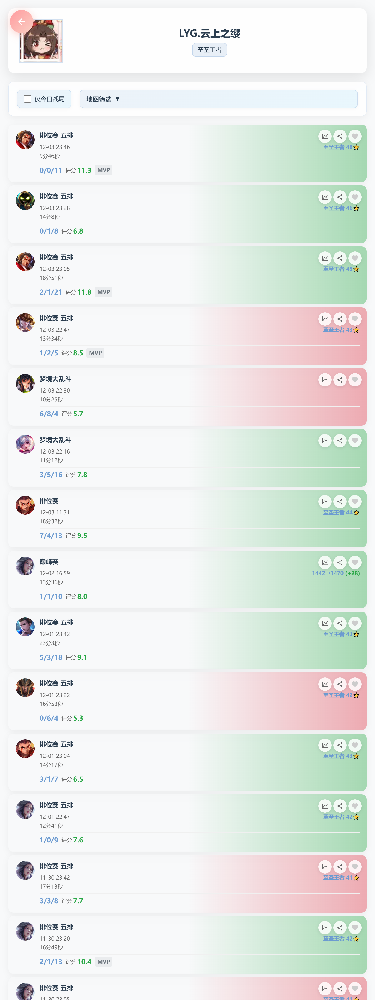
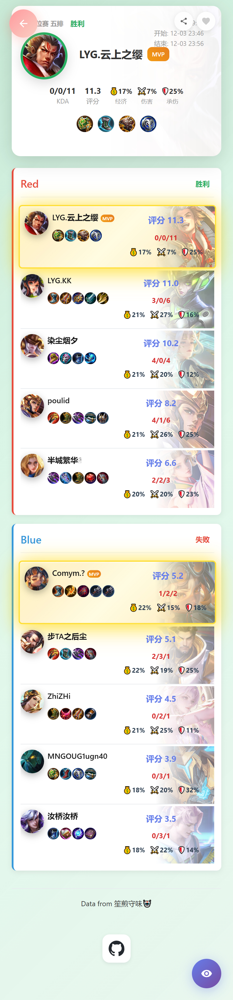

# GloryBond (QQ-HOK-Agent) User Manual

[](https://github.com/Raysance/GloryBond)

GloryBond是Bot与Web的唯一开发及部署仓库。实现、文档和部署脚本公开；用户信息、登录态和密钥保存在Git忽略的 `.env` 与 `config.yaml`。运行需要私有SDK访问授权及自己的配置，见[开发与部署说明](docs/DEVELOPMENT.md)。

完整功能手册与专题说明：

- [机器人功能手册](shared/agent/manual/handbook.md)
- [AI聊天、回复提及及忽略名单](shared/agent/manual/chapters/chat.md)
- [定时任务](shared/agent/manual/chapters/tasks.md)和[消息事件规则](shared/agent/manual/chapters/event_rules.md)
- [网页战绩展示](web/docs/battles.md)、[聊天运行记录](web/docs/chat.md)和[管理员账号登录态](web/docs/accounts.md)

开发与维护约定见 [AGENTS.md](AGENTS.md)。项目更新时同步维护两份文档：README 记录功能与用法，AGENTS 记录项目结构、模块职责和部署约定；相关功能手册一并更新。日常维护使用当前文档与部署入口，验证通过后清理旧副本、过期备份和一次性迁移材料。

玩家客户端已同步心跳与查询并发发送时的序号修复，接口和配置用法保持兼容；固定提交及升级说明见[玩家客户端部署说明](deployment/README.md#王者玩家客户端)，离线验证方式见[开发说明](docs/DEVELOPMENT.md#checks-and-manuals)。

## 目录

- [📖 总览](#-总览)
- [🎯 功能速查](#-功能速查)
- [🎮 核心功能](#-核心功能)
  - [一、战绩查询](#一战绩查询)
  - [二、英雄数据](#二英雄数据)
  - [三、数据分析](#三数据分析)
  - [四、智能对话](#四智能对话)
  - [五、其他](#五其他)
- [📞 常见问题](#-常见问题)
- [附录：指标计算方法](#附录指标计算方法)

---

## 📖 总览

GloryBond 是 QQ 群里的王者荣耀助手，支持战绩查询、英雄数据、实力评估和职业赛事查询，也能聊天、看图、画图、记住偏好和安排提醒。

- **固定功能**：发送 `#` + 命令，如 `#我的战绩`、`#今日英雄`。
- **智能对话**：直接 @机器人 后提问，如 `@机器人 分析一下我最近的表现`。
- **查询他人**：战绩、分析等命令中的“我”，可换成已登记的玩家昵称。
- **使用条件**：QQ 和游戏账号需先由管理员登记；战绩查询需要相应数据可见。

下文 `@机器人` 表示在 QQ 中实际选中机器人进行 @。图片为公开示例，实际数据以查询结果为准。

---

## 🎯 功能速查

| 功能 | 备注 | 示例 |
| --- | --- | --- |
| [排行榜](#1-排行榜查询) | 成员当日战绩 | `#排行` / `#排名` |
| [个人战绩](#2-个人战绩查询) | 今天、历史日期或区间 | `#我的战绩`、`#我昨天的战绩` |
| [巅峰排名](#3-在线状态与巅峰排名) | 已收录的历史排名 | `#巅峰排名` |
| [在线查询](#3-在线状态与巅峰排名) | 王者荣耀及 Steam 状态 | `#在线` |
| [历史对局](#4-历史对局条件查询) | 按条件筛选战绩 | `#查询我和昵称一起玩的排位赛` |
| [英雄战力](#1-英雄战力查询) | 玩家的高战力英雄 | `#我的战力` |
| [地区战力](#8-指定地区荣耀战力) | 指定英雄的地区榜 | `#战力查询 不知火舞 武侯区` |
| [英雄数据](#2-单玩家单英雄数据) | 场次、胜率、MVP 等 | `#我的安琪拉`、`#我的英雄` |
| [今日英雄](#6-今日英雄) | 个性化推荐 | `#今日英雄` |
| [英雄梯度](#7-英雄梯度) | 梯度长图 | `#梯度` |
| [评分分析](#1-评分分析) | 评分、段位趋势 | `#我的分析` |
| [数据总览](#2-总览) | 受益受害、极值、拿手英雄、组队交集 | `#总览b-7`、`#总览k-14` |
| [底蕴统计](#3-实力评估与底蕴) | 近7天已评估对局 | `#我的底蕴`、`#底蕴排行` |
| [对局预言](#4-对局预言与观战) | 当前对局双方实力 | `#我的预言` |
| [观战截图](#4-对局预言与观战) | 当前可观战对局 | `#我ob` |
| [游戏时长](#5-游戏时长) | 近两周王者及 Steam 时长和总时长占比 | `#我的时长`、`#时长排行` |
| [代表局](#6-代表局查询) | 指定日期的代表性对局 | `#代表局`、`#昨天代表局` |
| [实力评估](#3-实力评估与底蕴) | 查询战绩后戳一戳 | 戳一戳机器人 |
| [AI忽略名单](shared/agent/manual/chapters/chat.md#忽略与恢复ai聊天) | 群成员可持久忽略、恢复及查看本群AI请求名单 | `@机器人 忽略 @某人 的AI聊天` |
| [智能对话](#1-普通聊天) | 聊天、追问、分析 | `@机器人 我最近玩得怎么样？` |
| [看图与引用](#2-看图引用与群聊背景) | 图片、截图、动态表情 | 附图或引用后 `@机器人 这是什么？` |
| [群聊背景](#2-看图引用与群聊背景) | 查近期讨论或相关发言 | `@机器人 刚才大家在聊什么？` |
| [记忆管理](#3-记忆管理) | 保存、查看、纠正偏好 | `@机器人 记住我喜欢玩中路` |
| [清除记忆](#3-记忆管理) | 本人长期事实及当前对话 | `#清除记忆` |
| [角色与语气](#4-角色与回复风格) | 选择角色、调整表达 | `@机器人 切换成通用助手` |
| [联网查询](#5-联网图表与创作图片) | 最新资料与网页阅读 | `@机器人 查一下最近的版本改动` |
| [图表与图片](#5-联网图表与创作图片) | 数据图表、创作图片 | `@机器人 把我的英雄胜率画成柱状图` |
| [定时提醒](#6-定时提醒) | 延迟、周期和多次消息 | `@机器人 10分钟后提醒我休息` |
| [QQ 资料](#7-qq-资料与头像) | 群名片、昵称、头像 | `@机器人 我的群名片是什么？` |
| [表情包](#9-表情包生成) | 模板或自带参考图 | `#emoji 001 震惊但嘴硬` |
| [B站订阅](#4-b站-up-视频订阅) | 订阅、最新视频、取消 | `#订阅B站 罗翔`、`#最新视频` |
| [X 订阅](#5-x-账号订阅) | 原创帖、热门回复及译文 | `#订阅X @XDevelopers`、`#X最新内容` |
| [KPL 查询](#6-kpl-职业赛事) | 赛程、比分、选手和英雄数据 | `@机器人 今天KPL有什么比赛？` |
| [使用帮助](#1-使用帮助) | 查看说明、询问用法 | `#帮助` |

---

## 🎮 核心功能

### 一、战绩查询

#### 1. 排行榜查询

**触发方式**：`#排行` / `#排名`

**功能说明**：

- 显示成员当日上分榜、场次榜。
- 标注上分、掉分及场次最多的玩家。
- 附近期评分极值、受益受害统计和战绩网页。

#### 2. 个人战绩查询

**触发方式**：`#` + 玩家昵称 + `的战绩` + 可选日期

**使用示例**：

```text
#我的战绩
#我昨天的战绩
#昵称的战绩-8
#昵称的战绩7-14
```

依次查询今天、昨天、8天前、7至14天前的战绩。

**返回内容**：各模式场次、胜负、平均评分、段位变化和战绩网页；有可用详情时附最近一局的摘要及图片。



#### 3. 在线状态与巅峰排名

```text
#在线
#巅峰排名
```

- **在线**：查看已登记玩家的王者状态，以及已绑定 Steam 账号正在玩的游戏。
- **巅峰排名**：查看已收录的历史排名，不代表当前实时名次。

#### 4. 历史对局条件查询

**触发方式**：`#查询` + 条件描述

**功能说明**：按玩家、英雄、模式、日期、胜负、同局玩家、KDA、评分、时长及各类表现比较筛选。共鸣之战按模式筛选，可与MVP等成就条件组合。

**使用示例**：

```text
#查询我和昵称一起玩的排位赛中我评分更高的对局
#查询我最近7天用安琪拉获胜的对局
```

**返回内容**：匹配对局的胜率、评分等统计。只有1局时返回详情和图片，多局返回列表网页；没有匹配时会说明。

---

### 二、英雄数据

#### 1. 英雄战力查询

**触发方式**：`#` + 玩家昵称 + `的战力`

```text
#我的战力
#昵称的战力
```

返回高战力英雄、战力值及可用的地区排名。

#### 2. 单玩家单英雄数据

**触发方式**：`#` + 玩家昵称 + `的` + 英雄名

```text
#我的安琪拉
#昵称的露娜
```

返回本赛季英雄资料及近期表现，包括战力、胜负、胜率、评分、MVP 和 KDA 等。

#### 3. 单玩家多英雄数据

```text
#我的英雄
#昵称的英雄
#我本赛季的英雄
```

查看常用英雄、胜率榜和评分榜。常用英雄汇总默认近30天；可指定本赛季。

#### 4. 多玩家单英雄数据

```text
#群u的安琪拉
```

查看已登记玩家使用该英雄的场次、胜率、评分、模式分布和玩家榜单。

#### 5. 多玩家多英雄数据

```text
#群u的英雄
```

查看已登记玩家的英雄汇总，包括出场、胜率和评分榜。`群u` 表示已登记的玩家集合。

#### 6. 今日英雄

**触发方式**：`#今日英雄`

根据个人数据推荐英雄，附相关图片和推荐理由。仅支持本人，当日保留同一推荐结果。


#### 7. 英雄梯度

**触发方式**：`#梯度`

查看英雄梯度长图，展示各梯度英雄及头像。

#### 8. 指定地区荣耀战力

**触发方式**：`#` + 包含“战力”“查询”的英雄和地区描述

```text
#战力查询 不知火舞 武侯区
#查询安琪拉上海战力
```

返回指定英雄的地区荣耀战力信息。英雄名和地区名顺序不限。

---

### 三、数据分析

#### 1. 评分分析

**触发方式**：`#` + 玩家昵称 + `的分析`

```text
#我的分析
#昵称的分析
```

生成近期评分和段位变化图。



#### 2. 总览

| 命令 | 内容 |
| --- | --- |
| `#总览b-7` | 近7天玩家受益受害统计 |
| `#总览e-7` | 近7天最高、最低评分 |
| `#总览k-14` | 近14天各玩家拿手英雄 |
| `#总览i-7` | 近7天玩家组队交集 |
| `#总览h` | 近30天英雄受益受害统计 |

`b/e/k/i` 省略天数时默认近5天；`h` 固定查看近30天。

#### 3. 实力评估与底蕴

**触发方式**：查询个人战绩后，戳一戳机器人

**功能说明**：

- 评估待分析对局中双方玩家的底蕴，展示实力对比图。
- `#我的底蕴` 查看近7天已完成评估的正式对局统计。
- `#底蕴排行` 查看榜单，按对局双方团队底蕴均值排序。

```text
#我的战绩
（戳一戳机器人）
#我的底蕴
#底蕴排行
```



#### 4. 对局预言与观战

```text
#我的预言
#我ob
```

- **预言**：评估正在进行的对局，返回双方底蕴和实力对比。
- **观战**：对局可观战且读取成功时，返回画面截图。



#### 5. 游戏时长

```text
#我的时长
#昵称的时长
#时长排行
```

返回最近两周王者荣耀及已绑定 Steam 游戏的时长，并显示占所有已配置玩家总时长的比例。王者包含共鸣之战等已收录模式，不含大厅和排队时间；排行按同人账号合并后计算占比。

#### 6. 代表局查询

**触发方式**：`#代表局`，可带日期

```text
#代表局
#昨天代表局
#2026-10-14代表局
```

从指定日期的对局中，按高光、糟糕、极端三类指数挑选代表局。依次返回文字摘要、战绩长图和点评；省略日期默认今天。

各指标的含义、公式和统计范围见 [指标计算方法](docs/METRICS.md)。

---

### 四、智能对话

#### 1. 普通聊天

**触发方式**：直接 @机器人 后输入内容

```text
@机器人 分析一下我最近的表现
@机器人 和上周相比呢？
@机器人 把依据也展开给我看
```

支持连续追问、查询战绩和数据分析。群聊回复会 @ 本次提问者，通常简短回答；需要完整内容时可要求展开。内容较多时，可以按完整意思分几条发送。

#### 2. 看图、引用与群聊背景

```text
（附图片）@机器人 这张图里有什么？
（引用消息）@机器人 这句话是什么意思？
@机器人 刚才大家在聊什么？
```

- 可以理解图片、截图及可读取的动态表情；动画取部分画面理解。
- 可以读取本次明确引用的文字和图片，引用中的命令不会执行。
- 可以按需查当前群的近期讨论或相关历史发言。

#### 3. 记忆管理

```text
@机器人 记住我喜欢玩中路
@机器人 我现在主玩小乔，不玩安琪拉了
@机器人 你记得我的哪些偏好？
@机器人 忘记我喜欢安琪拉这条偏好
#清除记忆
```

保存本人稳定偏好，支持查看、纠正和删除。明确纠正也可更新记忆，不必每次说“记住”。普通群聊不会每天自动提炼成个人画像。

`#清除记忆` 清除本人长期事实及当前对话上下文；不删除群聊原始记录、运行记录、角色偏好或其他会话。正文加入 `nomem` 可让本次对话不使用长期记忆。

#### 4. 角色与回复风格

```text
@机器人 有哪些角色可以选？
@机器人 切换成通用助手
@机器人 联网添加《原神》的安柏并选用
@机器人 以后回复简短一点，少用表情
```

支持选择角色、添加新角色和保存个人表达偏好。角色选择仅影响本人的回复。
未扮演角色时，通用助手默认更坚定、有主见，直接给出判断和依据，发现错误会明确指出；个人表达偏好仍可调整语气。

AI 可读取当前请求使用的模型、已报告的 token 用量和执行进度，日常回复默认省略这些统计。需要了解时可直接询问，完整调用信息保存在运行记录中。

#### 5. 联网、图表与创作图片

```text
@机器人 联网查一下最近的版本改动，给我来源
@机器人 总结这篇文章 https://example.com/article
@机器人 把我最近的英雄胜率画成柱状图，标明场次
@机器人 画一张安琪拉在雨夜街头的插画
```

- **联网查询**：搜索资料、整理来源；直接提出要求即可，无需添加 `&`。
- **网页阅读**：读取正文或引用中的网页链接，整理文章重点。
- **统计绘图**：用查到的数据生成柱状图、折线图、热力图等。
- **创作图片**：按文字描述生成图片；使用参考图制作表情包见下文。

#### 6. 定时提醒

```text
@机器人 10分钟后提醒我休息
@机器人 每隔10秒发一条“喝水”，发三次
@机器人 每小时查一次指定话题的最新消息，共查两次
@机器人 看看我在这个会话里安排的任务
@机器人 取消刚才的提醒
```

支持一次提醒、周期消息和定时查询。后续消息发往创建任务的会话；周期任务默认等待一个周期后开始。

#### 7. QQ 资料与头像

```text
@机器人 我的群名片是什么？
@机器人 你的头像是什么？
@机器人 描述一下昵称的头像
```

查看当前群成员的昵称、群名片、头衔等资料，并读取头像内容。管理员还可用本次发送、引用或本轮生成的图片更换机器人头像。

#### 8. 戳一戳互动

直接戳一戳机器人，可随机收到文字或表情；有待分析对局或可用观战画面时，也可触发实力评估或截图。存在冷却限制。

#### 9. 表情包生成

**触发方式**：`#emoji`

```text
#emoji
#emoji 001 震惊但嘴硬
#emoji template=奶龙 prompt=委屈地说我没事
#emoji 模板=E1_001 提示词=做一个开心贴纸
```

支持随机模板、指定模板和自带参考图。使用自己的图片时，将图片与 `#emoji` 放在同一条消息中发送。未指定内容时，可结合本人在当前群的近期发言生成。

更多用法见 [智能对话说明](docs/CHAT.md)。

---

### 五、其他

#### 1. 使用帮助

发送 `#帮助` 获取说明入口，也可以直接询问功能用法。

```text
@机器人 你有哪些功能？
@机器人 底蕴是怎么算的？
@机器人 怎样订阅B站UP？
```

#### 2. 每日推送

每日 **23:30**，向已接入的推送群发送当日战报和代表局。代表局按“文字 → 图片 → 点评”展示，无需重复安排提醒。

#### 3. 网页链接

战绩、排行、单局详情和条件查询可附网页链接，方便在手机或电脑上查看完整明细及分享图片；链接过期后可重新查询。AI 回答也可附运行记录，查看详细回复及查询过程。




#### 4. B站 UP 视频订阅

```text
#订阅B站 罗翔
#我的订阅
#最新视频
#取消订阅 罗翔
```

- 支持按 UP 名称搜索，订阅多个 UP；改名后继续跟踪。
- 默认每5分钟检查新视频，推送标题、作者、发布时间、封面和链接。
- `#最新视频` 查看本人订阅 UP 的最新公开视频。
- 多个订阅时，取消需指定 UP 名称或账号 ID。

#### 5. X 账号订阅

```text
#订阅X @XDevelopers
#订阅X https://x.com/XDevelopers
#我的X订阅
#X最新内容
#取消X订阅 @XDevelopers
```

- 支持订阅多个账号，默认只推原创公开帖。
- 默认每5分钟检查，新帖发布至少5分钟后推送。
- 消息包含作者、发帖时间、中文预览、图卡和原帖链接。
- 图卡保留全文、配图、采样热门回复，以及英文内容的中文译文；长内容分页展示。

订阅与推送范围见 [订阅说明](docs/SUBSCRIPTIONS.md)。

#### 6. KPL 职业赛事

```text
@机器人 今天KPL有什么比赛？列出对阵和时间
@机器人 查今年KPL夏季赛安琪拉的选用次数和胜率
@机器人 查指定赛事的MVP次数榜和分均输出榜
@机器人 比较某队中野英雄组合的场次和胜率，画张热力图
```

支持赛程、系列赛比分、单局 BP、战队、选手、英雄、积分和榜单查询，数据来自 [KPL小助手](https://kplll.online/)。结果附赛事范围、样本及来源，收录可能有延迟。

另有赛后战报图，包含总比分及各小局表现；目前由管理员发起，自动赛果推送未默认开启。

---

## 📞 常见问题

**Q：为什么没有回复？**

A：检查是否实际 @ 到机器人、命令是否带 `#`，以及账号是否已登记。休眠、维护或冷却也会影响回复。引用中的 @ 不会单独触发聊天。

**Q：为什么查不到我的战绩？**

A：确认游戏账号已登记、王者营地已授权且战绩可见。未收录、条件不匹配或查询失败时，也可能查不到。

**Q：如何查看多天的数据？**

A：例如 `#我的战绩7-14` 查看7至14天前，`#查询我最近7天的排位赛` 按条件查对局。

**Q：底蕴和预言能判断谁一定赢吗？**

A：只能作为双方实力参考。授权、资料完整性及临场发挥都会影响结果。

**Q：订阅和偏好会因机器人重启丢失吗？**

A：成功保存的订阅和长期偏好会保留。定时任务在服务停止期间无法按时执行，恢复后不集中补发错过的消息。

**Q：订阅后会私聊通知我吗？**

A：B站和 X 自动推送发送到已接入的推送群；本人可随时用命令查看最新内容。

**Q：能查其他群的聊天吗？**

A：群内只查当前群；普通私聊不能读取群聊。管理员私聊可查询已授权群。

**Q：网页聊天与 QQ 一样吗？**

A：网页可以聊天、看图、查资料、分析、画图和安排提醒；QQ 命令、实时群成员资料及戳一戳需要在 QQ 使用。

---

## 附录：指标计算方法

| 指标 | 说明 |
| --- | --- |
| [受益受害](docs/METRICS.md#一受益受害指标) | 评分与胜率的相对关系 |
| [拿手英雄](docs/METRICS.md#二拿手英雄指标) | 胜率、评分和场次的综合表现 |
| [底蕴](docs/METRICS.md#三战局实力评估底蕴值) | 个人计算、双方实力及近期排行 |
| [团队贡献](docs/METRICS.md#四团队贡献系数) | 评分份额与经济占用 |
| [代表局](docs/METRICS.md#五代表局筛选指标) | 候选范围和三类指数 |
| [评分、英雄与时长](docs/METRICS.md#六其他统计范围) | 样本门槛、时间范围及单位 |

---

<div align="right">

**Raysance**

*2026-10-15*

</div>
